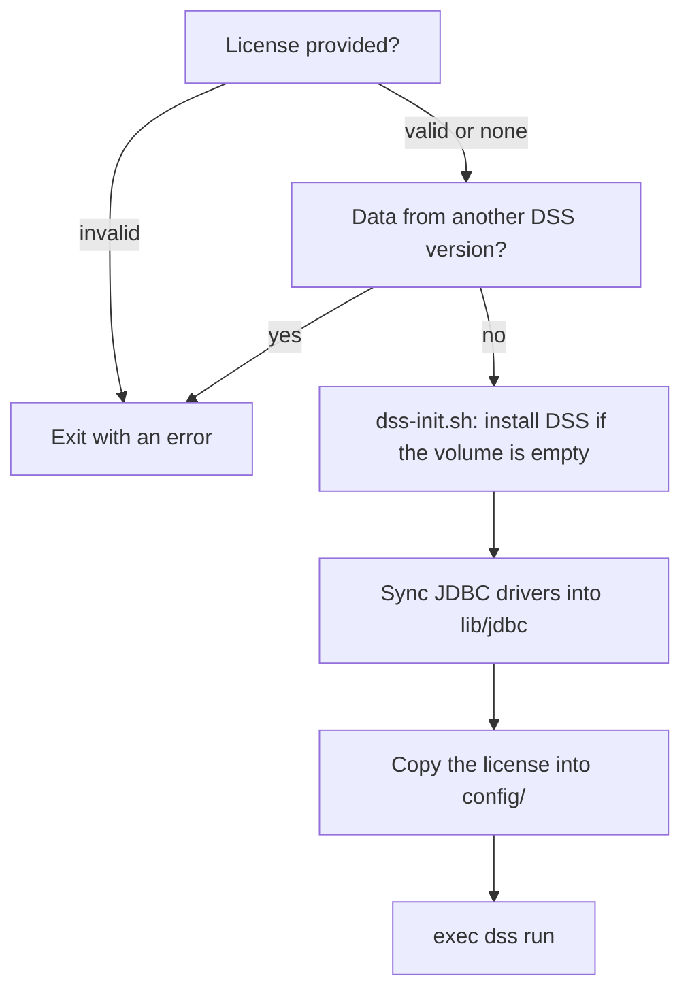

# How it works

## The problem

The official `dataiku/dss` image starts DSS with `/home/dataiku/run.sh`, which
leaves no room to add files to the data directory:

- The DSS installer only accepts an empty data directory, so files cannot be
  mounted into it before the first start.
- `run.sh` installs DSS (or upgrades it) and immediately runs `exec dss run`,
  with no hook in between.
- `dsscli set-license` needs a running DSS, then a restart. It also sends the
  license without a charset, so non-ASCII characters (such as `ç` in a name)
  are misread and a valid license is rejected as "not validly signed".

DSS reads its license from `<data dir>/config/license.json` at startup. The
image therefore puts the license, and the JDBC drivers, in place between the
installation and the start, so that DSS starts once, already configured.

## Build

[`image/Dockerfile`](../image/Dockerfile), on top of `DSS_BASE_IMAGE`:

1. Checks that the image tag matches the DSS version in the image. With a
   digest, Docker ignores the tag, so a mismatched digest would otherwise go
   unnoticed.
2. Derives `/home/dataiku/dss-init.sh` from `run.sh`, without its last line:

   ```shell
   grep -Fvx 'exec "$DSS_DATADIR"/bin/dss run' run.sh > dss-init.sh
   ```

   The build fails if that line is missing, so a change in a future base image
   cannot go unnoticed.
3. Downloads the JDBC drivers into `/home/dataiku/jdbc-drivers`
   ([`download-jdbc-drivers.sh`](../image/download-jdbc-drivers.sh)).
4. Sets [`start-dss.sh`](../image/start-dss.sh) as the container command, and
   adds a healthcheck.

## Startup



- Checks that can fail run first, before anything is changed.
- Every step is idempotent: a restart changes nothing unless the image, the
  instance's settings or the license changed.
- `exec` replaces the script with DSS, so DSS receives the container's stop
  signal. Compose's `init: true` adds a minimal init process in front.

## Runtime settings

Set in [`compose.base.yaml`](../compose.base.yaml) for every instance:

| Setting | Effect |
|---|---|
| `build.context: ./image` | Only `image/` is sent to Docker: the license and the instances never reach a build |
| `pull_policy: build` | Every `docker compose up` rebuilds the image, from cache, so changes always apply |
| `127.0.0.1:${DSS_HOST_PORT:-10000}:10000` | Host port from a Compose variable, local access only. See [Host port](instances.md#host-port) |
| `restart: on-failure:3` | Up to three retries after a failed start |
| `init: true` | Signal handling and process reaping |
| `no-new-privileges` | Processes cannot gain privileges |
| `./license` mount, read-only | Shared license, see [License](license.md) |

The healthcheck calls the DSS backend every 30 seconds:

```shell
curl -fsS -o /dev/null "http://127.0.0.1:$DSS_PORT/dip/api/ping"
```

It allows 10 minutes for a first start, which installs DSS.
